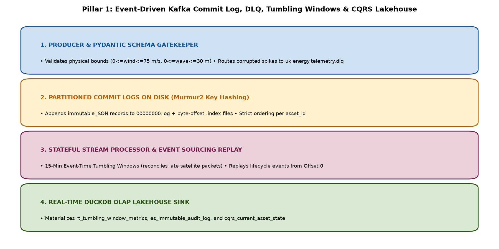

# Kafka Lakehouse Integration (`kafka-lakehouse-integration`)

Production Event-Driven Streaming, Schema Gatekeeping (DLQ), 15-Minute Event-Time Tumbling Windows, and Event Sourcing / CQRS into a DuckDB OLAP Lakehouse.



## Architectural Highlights
1. **Partitioned Commit-Log Broker (`src/broker_and_contracts.py`):** Deterministic key hashing (`asset_id`), physical `.log` and `.index` segments, and **Pydantic** Dead-Letter Queue (`uk.energy.telemetry.dlq`) routing.
2. **Event-Time Stream Processor (`src/stream_window_processor.py`):** 15-minute tumbling windows that reconcile out-of-order offshore satellite telemetry packets and commit consumer group offsets (`__consumer_offsets.json`).
3. **Event Sourcing & CQRS (`src/event_sourcing_and_lakehouse.py`):** Reconstructs live SAP Plant Maintenance lockout state from Offset 0 without destructive SQL `UPDATE` statements and sinks tables into **DuckDB**.

## Quickstart (via `uv`)
```bash
uv run python src/broker_and_contracts.py
uv run python src/stream_window_processor.py
uv run python src/event_sourcing_and_lakehouse.py
uv run pytest -v